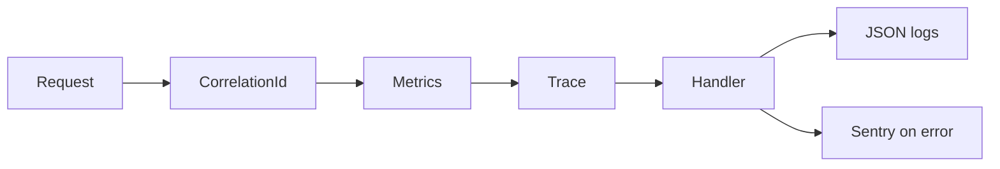

This is the final lesson of the module: you will build a small but complete service that combines all four pillars of observability — logs, traces, metrics and error handling — plus healthchecks and tests. This skeleton is what you will build in every production service.

## Project architecture

The project is called `orders_service`. Structure:

```
orders_service/
├── app/
│   ├── __init__.py
│   ├── main.py            # FastAPI, middleware, endpoints
│   ├── config.py          # settings from environment variables
│   ├── logging_setup.py   # JSON logs + correlation id
│   ├── telemetry.py       # OpenTelemetry: provider, instrumentation
│   ├── metrics.py         # Prometheus: Counter/Gauge/Histogram, /metrics
│   ├── sentry_setup.py    # Sentry: init, before_send
│   └── health.py          # liveness/readiness
├── tests/
│   ├── test_health.py
│   ├── test_metrics.py
│   └── test_app.py
├── requirements.txt
└── pytest.ini
```

Each module is responsible for one thing. This style (single responsibility) greatly simplifies debugging: if metrics don't appear — check `metrics.py`; if logs have no correlation id — `logging_setup.py`.

## Configuration via environment

All settings come from environment variables, with no hardcoded values (otherwise a prod config would end up in the repository):

```python
import os

LOG_LEVEL = os.getenv("LOG_LEVEL", "INFO")
OTEL_EXPORTER = os.getenv("OTEL_EXPORTER", "console")  # console | otlp
SENTRY_DSN = os.getenv("SENTRY_DSN", "")
```

In tests these same variables allow disabling Sentry and trace export to the network.

## Build order

1. **Config** — read environment variables.
2. **Logging** — JSON logs with `correlation_id` (contextvars + filter).
3. **Telemetry** — `TracerProvider` with `ConsoleSpanExporter` (in production — OTLP), `FastAPIInstrumentor.instrument_app(app)`.
4. **Metrics** — request counters, duration histogram, `/metrics` endpoint.
5. **Sentry** — `init()` with `before_send` (secret masking).
6. **Health** — `/healthz` and `/readyz`.

The middleware chain in `main.py` — one middleware per signal. `correlation_id` is set in `logging_setup` so all request logs share one id.

## What will be checked

Tests don't touch the network: `InMemorySpanExporter` instead of OTLP, `CollectingTransport` for Sentry, `DummyChecker` for readiness. This allows running `pytest` in CI without external services — and that is exactly how an "observable" application is verified.

## The request flow through observability layers

In the finished service, every request passes through several independent layers. It is important that they don't duplicate work and are linked by a common identifier:



`correlation_id` links logs together, `trace_id` links logs to a trace, and metrics provide aggregates for the same requests. That is why the order of middleware and filters is so important in the project.

## Best practices

- **One signal — one module**: logs, traces, metrics and errors should not be mixed in application code.
- **All external systems behind an interface**: checkers, exporters and transports can be swapped in tests.
- **Config via environment**: no secrets in code.
- **Tests must pass without the network and without real DSNs**: otherwise CI becomes unstable.

<!--TASK-->
### Task 1
Create the project structure `orders_service` with the files from the theory: `app/config.py` (variables `LOG_LEVEL`, `OTEL_EXPORTER`, `SENTRY_DSN` via `os.getenv`), `app/main.py` (FastAPI with a `GET /orders` endpoint returning `{"orders": []}`), `app/logging_setup.py` (a function `setup_logging()` with a JSON formatter and a `CorrelationIdFilter` filter), `requirements.txt` with the list: `fastapi`, `uvicorn`, `opentelemetry-sdk`, `opentelemetry-instrumentation-fastapi`, `prometheus-client`, `sentry-sdk`, `python-json-logger`, `pytest`, `httpx`. Check that `uvicorn app.main:app` starts and `/orders` answers 200.

### Task 2
Add to `app/main.py` a `CorrelationIdMiddleware` middleware: it reads the `X-Request-ID` header, if absent — creates a new one via `uuid4().hex`, stores it in `correlation_id` (contextvars), and puts it into the response header. In `app/logging_setup.py` attach `CorrelationIdFilter` (as in lesson 1). Write a pytest test in `tests/test_app.py`: create a `TestClient(app)`, make a request with header `X-Request-ID: req-123`, then check that the response contains header `X-Request-ID: req-123`, and in the logs (via a StringIO handler) the last record contains `correlation_id == "req-123"`. Run `pytest tests/ -v`.

### Task 3
Add OpenTelemetry setup to `app/telemetry.py`: `TracerProvider` with `Resource(service.name="orders-service")`, `BatchSpanProcessor`, with the exporter chosen by `OTEL_EXPORTER`: if `console` — `ConsoleSpanExporter`, if `otlp` — `OTLPSpanExporter(endpoint=...)` (a stub is fine). In `app/main.py` call `FastAPIInstrumentor.instrument_app(app)` after creating the application. Check that with `OTEL_EXPORTER=console`, after a request to `/orders`, a span named `GET /orders` appears in the console.

### Task 4
Add metrics to `app/metrics.py` (Counter `http_requests_total` with labels `method`, `status`; Histogram `http_request_duration_seconds` with buckets from lesson 3; Gauge `http_inflight_requests`) and a `/metrics` endpoint in `main.py`. Add `HealthChecker`, `DummyChecker`, `CachedHealthChecker` and `/healthz`, `/readyz` endpoints to `app/health.py`. Then write pytest tests in `tests/test_integration.py`: test 1 — `GET /healthz` → 200; test 2 — `GET /metrics` → 200 and contains the string `http_requests_total`; test 3 — after two requests to `/orders`, `/metrics` contains `http_requests_total{method="GET",status="200"} 2.0`. Run `pytest tests/ -v`.

### Task 5
Add to `app/sentry_setup.py` a function `init_sentry()` (SENTRY_DSN from config, `before_send=mask_secrets` from lesson 4, `transport=None` for tests) and wire it into `main.py`. Write a final test: `CollectingTransport` (from lesson 4), a request to `/orders`, check that the transport is empty (no errors), then `GET /orders?fail=1` (add an endpoint that raises `RuntimeError`) — check that `transport.events` contains an event with `exception`. Run the whole suite `pytest tests/ -v` and make sure all tests pass without the network.

### Task 6
Link logs to traces. Add to `app/logging_setup.py` a `TraceContextFilter` filter that takes `trace.get_current_span().get_span_context()` and, if `span_context.is_valid`, puts `trace_id` and `span_id` into the record in hex form (`format(span_context.trace_id, "032x")`, `format(span_context.span_id, "016x")`), otherwise sets `"-"`. Attach the filter to the handler together with `CorrelationIdFilter`. In `tests/test_trace_logs.py` configure `InMemorySpanExporter`, open a span `"checkout"`, log an event inside it and check that `record["trace_id"]` matches `format(span.get_span_context().trace_id, "032x")`, and outside the span the field equals `"-"`. Expected output: `1 passed`, every log line has a `trace_id`.

### Task 7
Build an SLO report from exposition text. In `app/slo.py` write a function `sum_counter(text: str, name: str) -> float` that sums the values of all series of the given counter (ignoring `# HELP` and `# TYPE`), and `error_ratio(text: str, threshold: float = 0.05) -> dict` returning `{"requests": ..., "errors": ..., "ratio": ..., "burning": bool}`. Count `requests` by `http_requests_total`, `errors` by `http_errors_total`; if there are zero requests, `ratio` is 0.0. In `tests/test_slo.py` pass a text with two request series (`5.0` and `3.0`) and one error series (`0.4`) and check `ratio == 0.05` and `burning is False`, then a text with `0.5` errors — `burning is True`. Expected output: `2 passed`.
<!--/TASK-->

<!--HINT-->
### Hint 1
`config.py`: `import os; LOG_LEVEL = os.getenv("LOG_LEVEL", "INFO")`. `main.py`: `from fastapi import FastAPI; app = FastAPI()`. Don't forget that `uvicorn app.main:app` runs from the `orders_service` folder (where `app/` lives). `requirements.txt` is just a list, without versions.

### Hint 2
Middleware: `@app.middleware("http")`; `request.headers.get("X-Request-ID") or uuid4().hex`; `correlation_id.set(value)`; `response.headers["X-Request-ID"] = value`. For logs: a `StringIO` handler in the test, the filter must be added to the handler. Remember: `TestClient` requires `app` to be imported before the test.

### Hint 3
`OTLPSpanExporter` is imported from `opentelemetry.exporter.otlp.proto.http.trace_exporter`. In the test you don't need to check anything automatically — it is enough that with `console` the span is printed to stdout. If `OTEL_EXPORTER=otlp` without a real collector — the exporter will silently retry; that's fine for a demo.

### Hint 4
In `metrics.py` create metrics at module level. Don't forget `CONTENT_TYPE_LATEST` and `generate_latest()`. Take `CachedHealthChecker` from lesson 5. In the test check via `client.get("/metrics").text`.

### Hint 5
Define `CollectingTransport` in `tests/conftest.py` or right in the test. `init_sentry` must accept `transport=None` so the test can pass `CollectingTransport()`. For `/orders?fail=1` — `raise RuntimeError("boom")` in the handler; `TestClient` returns 500, and Sentry catches the exception automatically. Don't forget to call `init_sentry(..., transport=transport)` **before** creating `TestClient` in the test.

### Hint 6
Import: `from opentelemetry import trace`. A valid context is `span_context.is_valid`, not a `None` check: an "empty" span has a context, but it is invalid. Format identifiers with leading zeros via `format(..., "032x")` and `format(..., "016x")` — otherwise strings will be different lengths and won't match the expectation. The filter should always return `True`, otherwise the record disappears.

### Hint 7
Parse lines one by one: skip empty lines and lines starting with `#`, then separate the metric name from the value via `rsplit(" ", 1)`. A series name may contain labels in curly braces — compare the part before `{`. Sum all series to get the total across all statuses and methods; compute `ratio` as `errors / requests`, and `burning` as `ratio > threshold`.
<!--/HINT-->

<!--SOLUTION-->
### Solution 1
Solution (`app/config.py`):

```python
import os

LOG_LEVEL = os.getenv("LOG_LEVEL", "INFO")
OTEL_EXPORTER = os.getenv("OTEL_EXPORTER", "console")
SENTRY_DSN = os.getenv("SENTRY_DSN", "")
```

Solution (`app/main.py`):

```python
from fastapi import FastAPI

app = FastAPI(title="Orders Service")

@app.get("/orders")
def list_orders():
    return {"orders": []}
```

`requirements.txt`:

```
fastapi
uvicorn
opentelemetry-sdk
opentelemetry-instrumentation-fastapi
prometheus-client
sentry-sdk
python-json-logger
pytest
httpx
```

What is going on here? This is the skeleton: config reads the environment, the application is minimal, dependencies are explicit. `httpx` is needed for `TestClient` (it uses httpx internally). Startup check: `uvicorn app.main:app --reload` → `http://127.0.0.1:8000/orders` → `{"orders":[]}`. From here on, all further code will grow around these files.

### Solution 2
Solution (`app/logging_setup.py`):

```python
import contextvars
import logging
from pythonjsonlogger import jsonlogger

correlation_id: contextvars.ContextVar[str] = contextvars.ContextVar("correlation_id", default="-")

class CorrelationIdFilter(logging.Filter):
    def filter(self, record: logging.LogRecord) -> bool:
        record.correlation_id = correlation_id.get()
        return True

def setup_logging(stream=None) -> logging.Logger:
    logger = logging.getLogger("orders")
    logger.handlers = []
    handler = logging.StreamHandler(stream)
    handler.setFormatter(jsonlogger.JsonFormatter(
        "%(asctime)s %(levelname)s %(message)s",
        rename_fields={"asctime": "timestamp", "levelname": "level"},
    ))
    handler.addFilter(CorrelationIdFilter())
    logger.addHandler(handler)
    logger.setLevel(logging.INFO)
    logger.propagate = False
    return logger
```

In `main.py`:

```python
import uuid
from fastapi import Request
from app.logging_setup import correlation_id, setup_logging

logger = setup_logging()

@app.middleware("http")
async def correlation_id_middleware(request: Request, call_next):
    value = request.headers.get("X-Request-ID") or uuid4().hex
    token = correlation_id.set(value)
    try:
        response = await call_next(request)
        response.headers["X-Request-ID"] = value
        return response
    finally:
        correlation_id.reset(token)
```

Test (`tests/test_app.py`):

```python
import io
import json
from fastapi.testclient import TestClient
from app.main import app

def test_correlation_id_in_logs():
    buf = io.StringIO()
    setup_logging(stream=buf)
    client = TestClient(app)
    resp = client.get("/orders", headers={"X-Request-ID": "req-123"})
    assert resp.headers["X-Request-ID"] == "req-123"
    record = json.loads(buf.getvalue().strip().splitlines()[-1])
    assert record["correlation_id"] == "req-123"
```

What is going on here? Middleware takes or creates the id, puts it into `contextvars`, and the filter picks it up into every record. The test checks end-to-end correlation: the id from the request header reached the JSON log.

### Solution 3
Solution (`app/telemetry.py`):

```python
from opentelemetry import trace
from opentelemetry.sdk.resources import Resource
from opentelemetry.sdk.trace import TracerProvider
from opentelemetry.sdk.trace.export import BatchSpanProcessor, ConsoleSpanExporter

from app.config import OTEL_EXPORTER

def setup_telemetry():
    provider = TracerProvider(resource=Resource.create({"service.name": "orders-service"}))
    if OTEL_EXPORTER == "console":
        exporter = ConsoleSpanExporter()
    else:
        from opentelemetry.exporter.otlp.proto.http.trace_exporter import OTLPSpanExporter
        exporter = OTLPSpanExporter(endpoint="http://collector:4318/v1/traces")
    provider.add_span_processor(BatchSpanProcessor(exporter))
    trace.set_tracer_provider(provider)
```

In `main.py`:

```python
from opentelemetry.instrumentation.fastapi import FastAPIInstrumentor
from app.telemetry import setup_telemetry

setup_telemetry()
FastAPIInstrumentor.instrument_app(app)
```

What is going on here? The exporter choice is moved to config. In production you set `OTEL_EXPORTER=otlp`, in development — `console`. `FastAPIInstrumentor` adds a span to every request. Check: with `OTEL_EXPORTER=console`, after a request a JSON description of the `GET /orders` span appears in stdout.

### Solution 4
Solution (`app/metrics.py`):

```python
from prometheus_client import CONTENT_TYPE_LATEST, Counter, Gauge, Histogram, generate_latest

HTTP_REQUESTS = Counter("http_requests_total", "Total HTTP requests", ["method", "status"])
HTTP_ERRORS = Counter("http_errors_total", "Total error responses", ["status"])
INFLIGHT = Gauge("http_inflight_requests", "Requests currently being processed")
REQUEST_DURATION = Histogram(
    "http_request_duration_seconds", "Request duration in seconds",
    buckets=(0.05, 0.1, 0.25, 0.5, 1.0, 2.5, 5.0),
)

def metrics_response():
    from fastapi.responses import Response
    return Response(content=generate_latest(), media_type=CONTENT_TYPE_LATEST)
```

In `main.py`:

```python
import time
from app.metrics import (HTTP_ERRORS, HTTP_REQUESTS, INFLIGHT,
                         REQUEST_DURATION, metrics_response)

@app.middleware("http")
async def metrics_middleware(request: Request, call_next):
    INFLIGHT.inc()
    start = time.perf_counter()
    try:
        response = await call_next(request)
    finally:
        REQUEST_DURATION.observe(time.perf_counter() - start)
        INFLIGHT.dec()
    if response.status_code >= 400:
        HTTP_ERRORS.labels(status=str(response.status_code)).inc()
    HTTP_REQUESTS.labels(method=request.method, status=str(response.status_code)).inc()
    return response

@app.get("/metrics")
def metrics():
    return metrics_response()
```

Test (`tests/test_integration.py`):

```python
from fastapi.testclient import TestClient
from app.main import app

def test_healthz():
    assert TestClient(app).get("/healthz").status_code == 200

def test_metrics_endpoint():
    client = TestClient(app)
    resp = client.get("/metrics")
    assert resp.status_code == 200
    assert "http_requests_total" in resp.text

def test_metrics_counts_requests():
    client = TestClient(app)
    client.get("/orders")
    client.get("/orders")
    text = client.get("/metrics").text
    assert 'http_requests_total{method="GET",status="200"} 2.0' in text
```

What is going on here? Metrics count only real requests: two calls to `/orders` give 2.0 in the counter. Note: the request to `/metrics` itself also increments the counter, so the check is done **after** reading the text — more precisely, the already-rendered text with the last request already included is read.

### Solution 5
Solution (`app/sentry_setup.py`):

```python
import sentry_sdk
from app.config import SENTRY_DSN

def mask_secrets(event: dict):
    extra = event.get("extra", {})
    for key in list(extra):
        if "password" in key.lower() or "token" in key.lower():
            extra[key] = "***"
    return event

def init_sentry(transport=None):
    sentry_sdk.init(
        dsn=SENTRY_DSN,
        environment="production",
        release="orders@1.0.0",
        traces_sample_rate=0.5,
        before_send=mask_secrets,
        transport=transport,
    )
```

In `main.py`:

```python
@app.get("/orders")
def list_orders(fail: int = 0):
    if fail:
        raise RuntimeError("boom")
    return {"orders": []}
```

Test:

```python
from sentry_sdk.transport import Transport
from app.sentry_setup import init_sentry

class CollectingTransport(Transport):
    def __init__(self, options=None):
        super().__init__(options)
        self.events = []
    def capture_envelope(self, envelope):
        event = envelope.get_event()
        if event is not None:
            self.events.append(event)

def test_no_errors_on_ok():
    transport = CollectingTransport()
    init_sentry(dsn="https://public@o0.ingest.us.sentry.io/0", transport=transport)
    TestClient(app).get("/orders")
    assert transport.events == []

def test_error_captured():
    transport = CollectingTransport()
    init_sentry(dsn="https://public@o0.ingest.us.sentry.io/0", transport=transport)
    client = TestClient(app, raise_server_exceptions=False)
    client.get("/orders?fail=1")
    assert len(transport.events) == 1
    assert "exception" in transport.events[0]
```

What is going on here? A successful request produces no events. An erroneous one is automatically captured by the ASGI integration and lands in `CollectingTransport`. The tests are fully self-contained: none of them uses the network, so `pytest tests/ -v` passes in CI without external services. That is the final check of an "observable" application.

### Solution 6
Solution (`app/logging_setup.py`, fragment):

```python
import logging

from opentelemetry import trace

class TraceContextFilter(logging.Filter):
    def filter(self, record: logging.LogRecord) -> bool:
        span_context = trace.get_current_span().get_span_context()
        if span_context.is_valid:
            record.trace_id = format(span_context.trace_id, "032x")
            record.span_id = format(span_context.span_id, "016x")
        else:
            record.trace_id = "-"
            record.span_id = "-"
        return True

# when configuring the handler:
# handler.addFilter(CorrelationIdFilter())
# handler.addFilter(TraceContextFilter())
```

Test (`tests/test_trace_logs.py`):

```python
import io
import json
import logging

from opentelemetry import trace
from opentelemetry.sdk.trace import TracerProvider
from opentelemetry.sdk.trace.export import SimpleSpanProcessor
from opentelemetry.sdk.trace.export.in_memory_span_exporter import InMemorySpanExporter

from app.logging_setup import TraceContextFilter

def test_trace_id_in_logs():
    exporter = InMemorySpanExporter()
    provider = TracerProvider()
    provider.add_span_processor(SimpleSpanProcessor(exporter))
    tracer = provider.get_tracer("test")

    stream = io.StringIO()
    handler = logging.StreamHandler(stream)
    handler.setFormatter(logging.Formatter("%(trace_id)s"))
    handler.addFilter(TraceContextFilter())
    logger = logging.getLogger("trace-test")
    logger.handlers = [handler]
    logger.setLevel(logging.INFO)
    logger.propagate = False

    with tracer.start_as_current_span("checkout") as span:
        expected = format(span.get_span_context().trace_id, "032x")
        logger.info("inside span")

    logger.info("outside span")
    lines = stream.getvalue().strip().splitlines()
    assert lines[0] == expected
    assert lines[1] == "-"
```

What is going on here? Logs and traces are different signals, but without a common link they are useless: you see a slow span but don't know which records belong to it. `TraceContextFilter` takes the current span from the OTel context (the same `contextvars` mechanism as correlation id) and adds two fields to every record. `is_valid` is the right check: an inactive span has a zero `trace_id`, and without it "zero" identifiers that lead nowhere would appear in logs. Hex formatting with fixed width matches what Jaeger or Tempo show, so you can copy the identifier from a log straight into trace search. In production such a filter is attached to the same handler as the JSON formatter and adds no noticeable overhead.

### Solution 7
Solution (`app/slo.py`):

```python
def sum_counter(text: str, name: str) -> float:
    total = 0.0
    for line in text.splitlines():
        line = line.strip()
        if not line or line.startswith("#"):
            continue
        series, _, raw_value = line.rpartition(" ")
        metric_name = series.split("{", 1)[0]
        if metric_name == name:
            total += float(raw_value)
    return total

def error_ratio(text: str, threshold: float = 0.05) -> dict:
    requests = sum_counter(text, "http_requests_total")
    errors = sum_counter(text, "http_errors_total")
    ratio = errors / requests if requests else 0.0
    return {
        "requests": requests,
        "errors": errors,
        "ratio": ratio,
        "burning": ratio > threshold,
    }
```

Test (`tests/test_slo.py`):

```python
from app.slo import error_ratio

SAMPLE = """
# HELP http_requests_total Total requests
# TYPE http_requests_total counter
http_requests_total{method="GET",status="200"} 5.0
http_requests_total{method="GET",status="500"} 3.0
http_errors_total{status="500"} 0.4
"""

def test_ratio_at_threshold():
    report = error_ratio(SAMPLE)
    assert report["requests"] == 8.0
    assert report["errors"] == 0.4
    assert report["ratio"] == 0.05
    assert report["burning"] is False

def test_ratio_above_threshold():
    text = SAMPLE.replace("0.4", "0.5")
    assert error_ratio(text)["burning"] is True
```

What is going on here? The exposition format is plain text, so an SLO report can be built without Prometheus and without the network — for example in CI after a load test. `sum_counter` sums all series with the given name: we care about the total error share, not an individual label combination. `rpartition(" ")` separates the value from the right, and `split("{", 1)[0]` cuts labels off the name — so the same code works both for `http_requests_total 10.0` and for a series with labels. The `requests == 0` check protects against division by zero at startup, when counters don't exist yet. The `0.05` threshold is the same 5% as in the alert rule from lesson 5: the calculation and the alert must use one formula, otherwise the dashboard and the alarm will diverge.
<!--/SOLUTION-->

<!--QUIZ-->
Why is configuration moved to environment variables?
- To make the code shorter
- So prod settings and secrets don't end up in the repository
- To speed up startup
* Correct answer: So prod settings and secrets don't end up in the repository
The environment lets you change behavior without editing code.

What does FastAPIInstrumentor.instrument_app(app) do?
- Adds /metrics
- Enables tracing for each request
- Enables logging
* Correct answer: Enables tracing for each request
Instrumentation wraps the application to create spans.

Which endpoint serves metrics?
- /healthz
- /metrics
- /readyz
* Correct answer: /metrics
Prometheus polls /metrics in the exposition format.

What does CorrelationIdMiddleware do?
- Reads/creates X-Request-ID and puts it into contextvars
- Counts metrics
- Sends exceptions to Sentry
* Correct answer: Reads/creates X-Request-ID and puts it into contextvars
This links a log and a trace to a specific request.

Why CollectingTransport in tests?
- To speed up sending
- To verify Sentry events without the network
- To encrypt events
* Correct answer: To verify Sentry events without the network
The transport intercepts events instead of sending them to the network.

What does CachedHealthChecker do?
- Checks the Redis cache
- Caches the readiness check result for ttl seconds
- Sends metrics
* Correct answer: Caches the readiness check result for ttl seconds
Repeated requests don't hammer the dependency.

Which of the following is NOT an observability signal?
- Logs
- Traces
- Screenshots
* Correct answer: Screenshots
Signals are traces, metrics, logs.

Why is it important "not to use the network" in tests?
- It is faster
- It makes tests deterministic and stable in CI
- It is a mandatory pytest requirement
* Correct answer: It makes tests deterministic and stable in CI
External services are unavailable in CI and make tests flaky.

What does the final integration test with /orders?fail=1 check?
- That the app responds 200
- That Sentry automatically captured the exception
- That metrics were zeroed
* Correct answer: That Sentry automatically captured the exception
Automatic exception capture by the ASGI integration is the key check.

Why a separate module per observability signal?
- To make the code prettier
- To be able to change and debug each signal independently
- To reduce the number of files
* Correct answer: To be able to change and debug each signal independently
Separation of concerns simplifies maintenance.

Why add trace_id to JSON logs?
- To link a log record to a specific trace
- To reduce log size
- To replace correlation_id
* Correct answer: To link a log record to a specific trace
The identifier can be copied into Jaeger or Tempo to see the whole request path.

How to check whether the current span is active?
- span_context.is_valid
- span is None
- trace_id == 0
* Correct answer: span_context.is_valid
An inactive span has a context, but it is invalid.

Why validate configuration at startup?
- So the app fails immediately with a clear error rather than on the first request
- To speed up module imports
- To disable logging
* Correct answer: So the app fails immediately with a clear error rather than on the first request
Fail-fast saves diagnosis time in production.

Why does the SLO report sum all series of http_requests_total?
- We care about the total error share across the service, not per individual label
- This way Python works faster
- Otherwise Prometheus won't collect metrics
* Correct answer: We care about the total error share across the service, not per individual label
Summing across series gives the correct denominator for ratio.
<!--/QUIZ-->
