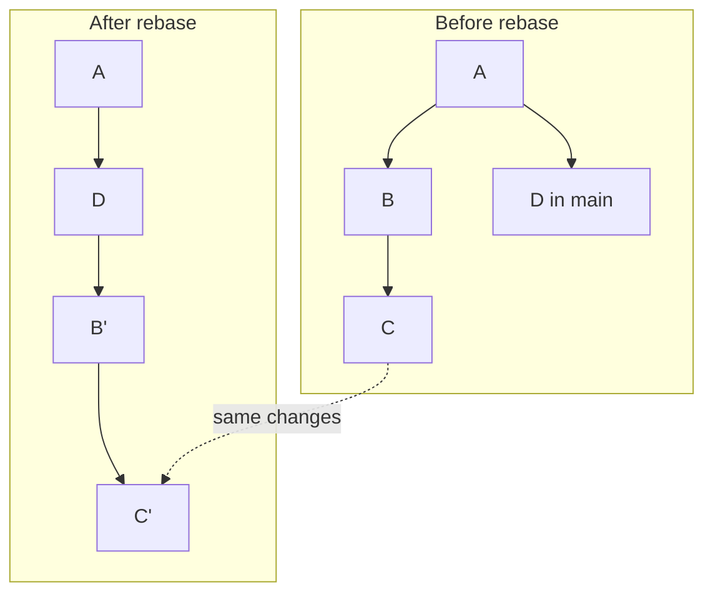

`git merge` and `git rebase` solve the same problem — joining two branches — but in different ways. Merge creates a separate "merge" commit and preserves the branching. Rebase **rewrites** the commits of one branch and places them on top of a new base, making history perfectly linear. For open-source and team work this is the golden standard: linear history is easy to read, easy to review, and easy to search with `git bisect` for the first commit that broke something (more about this in lesson 3).

## How rebase works

Imagine you have `main` with commit `A`, and branch `feature`, where `B` and `C` sit on top of `A`:

```
main:   A
feature: A -> B -> C
```

After `git rebase main` (while on `feature`), Git takes commits `B` and `C`, "cuts" them off the branch and applies them again on top of the latest commit of `main`. If a new commit `D` appeared in `main`, history becomes:

```
main:    A -> D
feature:  A -> D -> B' -> C'
```

`B'` and `C'` are **new** commits with new hashes and a new parent, although their content is the same. Hence rule number one: **never rebase commits that someone has already pushed to a shared repository** — you will rewrite the shared history and your colleagues will end up with divergent repositories.

What is the advantage over merge? History without "junk" merge commits, and every commit in `feature` looks as if it was made directly on top of the up-to-date `main`. This simplifies review: a colleague sees only your actual changes.

## What happens to history

It is useful to see the two pictures side by side once: before rebase, branch `feature` branches off old `A`; after, its commits sit on top of fresh `D`. The old `B` and `C` remain in the reflog, but in branch history they are replaced by `B'` and `C'`.



It is precisely the change of parent that changes the hash: the content of `B'` and `B` may match, but the `parent` is different, and so the SHA is different too.

## Practice: basic rebase

```bash
# start from an up-to-date main
git checkout main
git pull --rebase

# create a branch and work
git checkout -b feature/login-form
# ... make changes ...
git add .
git commit -m "feat: add login form"

# when main has moved forward — rebase
git checkout main
git pull --rebase          # updated main
git checkout feature/login-form
git rebase main
```

If there are no conflicts, Git silently replays the commits. Look at the result:

```bash
git log --graph --oneline --all --decorate
```

Note: `log` shows a single line, with no "forks".

## Interactive rebase

`git rebase -i HEAD~3` opens an editor with a list of commits:

```
pick 1a2b3c feat: add login form
pick 4d5e6f fix: fix validation
pick 7g8h9i docs: comments for the form
```

By changing the first word of a line, you can:

- `pick` — keep the commit as is;
- `reword` — change the commit message;
- `squash` — fold the commit into the previous one (merge);
- `fixup` — same, but without asking for a message (used for small fixes);
- `drop` — delete the commit;
- `edit` — stop to change the content.

To squash two commits into one: set `squash` on the second:

```
pick 1a2b3c feat: add login form
squash 4d5e6f fix: fix validation
```

After saving, Git will ask you to enter a new combined message. Result: instead of two commits — one that contains the changes of both.

Attention: `-i` also rewrites the **last** commit — if it has already been pushed, that is forbidden by the rule above.

## cherry-pick: move a commit to another branch

Sometimes you need to apply a **specific** commit to another branch without dragging the whole branch along. For example, a bug fix on `main` must be duplicated into a release branch:

```bash
git log --oneline main -5     # find the hash of the needed commit
git checkout release/1.4
git cherry-pick 3f2a1b
```

Git applies the changes of that commit as a new commit on top of `release/1.4`. Several in a row:

```bash
git cherry-pick ab12cd3 de4ef56
```

Or a whole range from `old` (exclusive) to `new` (inclusive):

```bash
git cherry-pick old..new
```

If a conflict arises, Git stops: resolve it (lesson 2) and continue with `git cherry-pick --continue`, or cancel the whole venture with `git cherry-pick --abort`. The `--no-commit` flag (`-n`) applies changes but does not create a commit — convenient when you want to fold several fixes into one commit.

## When to choose what

- **Public shared branch** (`main`, `develop`) — only merge or squash-merge via PR, no rewriting.
- **Personal feature branch** — feel free to rebase and squash, it is not published yet.
- **Moving a single fix** to a release — cherry-pick.
- **Order of commits in your own branch** — interactive rebase.

Rebase does not delete old commits forever: Git keeps them for ~90 days in `reflog` (lesson 3), so a "broken" rebase can almost always be rolled back.

<!--TASK-->
### Task 1
Create a temporary repository in an empty folder and act out a "messy" divergence scenario:

1. `git init`; set `user.name` and `user.email`.
2. On `main` create file `app.py` with one line `VERSION = "1.0"` and commit it.
3. Create branch `feature`, add line `FEATURE = True` to `app.py` and commit.
4. Return to `main`, add line `BUGFIX = True` and commit too.
5. Switch to `feature` and run `git rebase main`.
6. Run `git log --oneline --graph --all` and check: history is linear, both our commits are in place, and the first commit is the one with `BUGFIX`.

Expected result: the output of `git log --graph` has no `|/` symbol (forks), and exactly three commits are visible in a single line. Write the output of `git log --oneline -5` into a notebook — you will need it in task 5.

### Task 2
Write a pytest test `test_rebase.py` that checks on a temporary repository that rebase moves branch commits on top of the new `main` base. Use `tempfile.TemporaryDirectory`, `subprocess.run` and the helper `git(*args, cwd=repo)`. Scenario: `main` — commit `A`; branch `feature` from `A` — commits `B`, `C`; then commit `D` is added to `main`; after `git rebase main`, `feature` should have: (a) a commit with message `D` in history, (b) commits `B` and `C` with the same messages, (c) the first parent of the top commit of `feature` — the top commit of `main`. Run `pytest test_rebase.py -v`: expected result — `1 passed` without skips.

### Task 3
Interactive rebase. In the repository from task 1 (or a new one) make **three** commits in a row on one branch: `feat: skeleton`, `fix: typo`, `docs: clarification`. Then run `git rebase -i HEAD~3` and:

- squash `fix` and `docs` into `feat` via `squash` (result — one commit `feat: skeleton`);
- then `git rebase -i HEAD~1` with `reword` to rename it to `feat: skeleton with fixes`.

Check `git log --oneline`: there must be exactly one line. Expected result: `git log --oneline` outputs one commit with the new message, and `git status` — "nothing to commit" (clean working tree).

### Task 4
Write a pytest test `test_cherry_pick.py`: create a temporary repository, branch `feature` with a commit that changes a file (e.g. adds line `C = 3`), then return to `main`, add another commit, and run `git cherry-pick <sha_feature>`. Check: (a) `main` now contains the change `C = 3`, (b) the hash of the new commit is not equal to the original, (c) the commit message matches the original, (d) `feature` remained untouched (contains the original commit). Run `pytest test_cherry_pick.py -v`: expected result — `1 passed`.

### Task 5
Take the output of `git log --oneline -5` from task 1 and imagine that `feature` is a release branch and two bugs were found on `main`. Cherry-pick a **range** of commits:

```bash
git checkout -b hotfix
git cherry-pick <sha_bug1>..<sha_bug2>
```

(where `<sha_bug1>` and `<sha_bug2>` are hashes of commits from the log output). Check `git log --oneline`. Expected result: two new commits with the same messages as the bugs appear in `hotfix`, and their count equals the number of commits in the range.

### Task 6
Master `git rebase --onto` when you need to move not the whole branch but only its tail. In a temporary repository create commit `A` (`base.py`) on `main`, then branch `feature` with commits `B` (`b.py`), `C` (`c.py`) and `D` (`d.py`). Return to `main` and add commit `E` (`main.py`). Remember the hash of `B` and run `git rebase --onto main <sha_B> feature`. Check via `git log --format=%s feature` that the branch still has `D`, `C`, `E`, `A`, and commit `B` is absent. Expected output: four messages in reverse chronological order and no `B`.

### Task 7
Break down two cherry-pick flags. In a repository with branches `main` and `release`, make commit `fix: rounding` on `main` and move it to `release` with `git cherry-pick -x <sha>`. Check that `git log -1 --format=%B` contains the line `(cherry picked from commit <sha>)`. Then make a second fix on `main`, apply it via `git cherry-pick -n <sha>`, make sure `HEAD` did not change and `git status --porcelain` shows the modified file, and only then commit both changes as one commit `release: rounding fixes`. Expected output: two commits in `release`, the first containing a reference to the original.

<!--/TASK-->

<!--HINT-->
### Hint 1
After `git rebase main` look at `git log --oneline --graph --all`. Linear history means there is no "fork" in the first column of the graph. If there is one, rebase did not happen or you are not on `feature`. Check the current branch: `git branch --show-current`.

### Hint 2
Helper: `def git(*args, cwd): subprocess.run(["git", *args], cwd=cwd, check=True, capture_output=True, text=True)`. Take the commit hash via `git rev-parse main`; the first parent via `git rev-parse feature~1`. To create a branch with commits, go step by step: `git checkout -b feature`, edit the file, `git add`, `git commit`. Do not forget to set `user.name`/`user.email` in the test, otherwise commits will fail.

### Hint 3
In the rebase editor the lines go top to bottom: the first is the oldest commit. To merge, replace `pick` with `squash` on the `fix` and `docs` lines. After saving, Git opens the message editor — keep the first or type your own and save. For `reword` in `-i HEAD~1` just change the line from `pick` to `reword`, then edit the message.

### Hint 4
After `git cherry-pick` check the file content with `read_text()`, and the hash via `git rev-parse HEAD` before and after the cherry-pick. Compare messages via `git log -1 --format=%s`. To get the feature sha before switching to main, save it in a variable beforehand: `sha_feature = git("rev-parse", "feature")`.

### Hint 5
The range `A..B` includes commits after `A` up to and including `B`. If `hotfix` ended up with more commits than expected, check that `A` is exactly the commit after which the transferred ones should go. You can cancel a mistaken cherry-pick with `git cherry-pick --abort`.

### Hint 6
Syntax: `git rebase --onto <new_base> <commit_after_which> <branch>` — the commits that are in `<branch>` but not in `<commit_after_which>` are moved, i.e. `B` itself is not moved. Get the hash of `B` via `git rev-parse feature~2` or `git log --format=%H --grep="^B$"`. If you mix up the arguments, Git may say `fatal: invalid upstream`, so check the order: first `main`, then `B`, then `feature`.

### Hint 7
`-x` appends the line `(cherry picked from commit ...)` to the message — convenient for auditing a release branch. `-n` (`--no-commit`) applies changes to the index and working tree but does not create a commit: `HEAD` stays the same, and `git status` shows staged files. After `-n` you can add more changes and make one common commit.

<!--/HINT-->

<!--SOLUTION-->
### Solution 1
Working scenario:

```bash
mkdir rebase-demo && cd rebase-demo
git init
git config user.name "Test"
git config user.email "test@example.com"

echo 'VERSION = "1.0"' > app.py
git add app.py && git commit -m "feat: base version"

git checkout -b feature
echo 'FEATURE = True' >> app.py
git add app.py && git commit -m "feat: feature"

git checkout main
echo 'BUGFIX = True' >> app.py
git add app.py && git commit -m "fix: bug"

git checkout feature
git rebase main
git log --oneline --graph --all
```

The first two commits (base version and feature) are made on `feature`; then `main` moves forward by one commit. After `git rebase main` Git takes the feature commit from branch `feature` and lays it on top of `main`. The final graph is one straight line:

```
* (feature) feat: feature
* (main) fix: bug
* feat: base version
```

Note: interestingly, the feature commit now "looks" as if it was created after the bug fix, although chronologically it is older. That is the essence of rebase — history becomes linear rather than chronological. If we had merged, a third merge commit and a fork in the graph would have appeared.

### Solution 2
Full solution:

```python
import subprocess
import tempfile
from pathlib import Path

import pytest


def git(*args, cwd):
    return subprocess.run(
        ["git", *args], cwd=cwd, check=True,
        capture_output=True, text=True,
    ).stdout.strip()


def commit_file(repo, name, content, message):
    (Path(repo) / name).write_text(content)
    git("add", name, cwd=repo)
    git("commit", "-m", message, cwd=repo)


def test_rebase_moves_commits():
    with tempfile.TemporaryDirectory() as repo:
        git("init", cwd=repo)
        git("config", "user.name", "Test", cwd=repo)
        git("config", "user.email", "test@example.com", cwd=repo)

        commit_file(repo, "a.txt", "A\n", "A")
        git("checkout", "-b", "feature", cwd=repo)
        commit_file(repo, "a.txt", "A\nB\n", "B")
        commit_file(repo, "b.txt", "C\n", "C")

        git("checkout", "main", cwd=repo)
        commit_file(repo, "a.txt", "A\nD\n", "D")

        git("checkout", "feature", cwd=repo)
        git("rebase", "main", cwd=repo)

        main_head = git("rev-parse", "main", cwd=repo)
        feature_head = git("rev-parse", "feature", cwd=repo)
        parent = git("rev-parse", "feature~1", cwd=repo)

        assert parent == main_head
        messages = git("log", "--format=%s", "main..feature", cwd=repo)
        assert "B" in messages and "C" in messages
        assert "D" not in messages
```

What happens here: the test creates a repository in a temporary folder, the `commit_file` helper makes commits (the file content is written entirely, so `A\nB\n` means "add line B"). Checks: the top commit of `feature` points to the top commit of `main` as first parent — so history is linear, without a merge commit. The range `main..feature` shows only commits that are not in `main` — B and C must be there, but not D. Run: `pytest test_rebase.py -v` → `1 passed`.

### Solution 3
Commands:

```bash
echo 'x = 1' > step1.py && git add step1.py
git commit -m "feat: skeleton"
echo 'x = 2' >> step1.py && git add step1.py
git commit -m "fix: typo"
echo '# see the docs' >> step1.py && git add step1.py
git commit -m "docs: clarification"

git rebase -i HEAD~3
```

In the editor:

```
pick f111111 feat: skeleton
squash f222222 fix: typo
squash f333333 docs: clarification
```

We save; Git asks for the final message — we write `feat: skeleton with fixes`. Then:

```bash
git rebase -i HEAD~1   # reword
```

Change `pick` to `reword` and the message to `feat: skeleton with fixes`. Check:

```bash
git log --oneline
# feat: skeleton with fixes
```

Why `squash` works: Git sequentially applies the selected commits on top of the previous one and after each "melts" its content into one final commit. Important: `squash` itself does not change the content — only the number of commits and the message change. `reword` is a purely cosmetic operation: the hash changes because the message participates in hash computation, but file content is not touched.

### Solution 4
Solution:

```python
import subprocess
import tempfile
from pathlib import Path

import pytest


def git(*args, cwd):
    return subprocess.run(
        ["git", *args], cwd=cwd, check=True,
        capture_output=True, text=True,
    ).stdout.strip()


def commit_file(repo, name, content, message):
    (Path(repo) / name).write_text(content)
    git("add", name, cwd=repo)
    git("commit", "-m", message, cwd=repo)


def test_cherry_pick_applies_single_commit():
    with tempfile.TemporaryDirectory() as repo:
        git("init", cwd=repo)
        git("config", "user.name", "Test", cwd=repo)
        git("config", "user.email", "test@example.com", cwd=repo)

        commit_file(repo, "app.py", "A = 1\n", "base")
        sha_feature = git("rev-parse", "HEAD", cwd=repo)

        git("checkout", "-b", "feature", cwd=repo)
        commit_file(repo, "app.py", "A = 1\nC = 3\n", "feat: add C")
        sha_orig = git("rev-parse", "feature", cwd=repo)

        git("checkout", "main", cwd=repo)
        commit_file(repo, "app.py", "A = 1\nB = 2\n", "feat: add B")

        git("cherry-pick", sha_orig, cwd=repo)

        content = (Path(repo) / "app.py").read_text()
        assert "C = 3" in content
        sha_new = git("rev-parse", "HEAD", cwd=repo)
        assert sha_new != sha_orig
        assert git("log", "-1", "--format=%s", cwd=repo) == "feat: add C"
        assert git("rev-parse", "feature", cwd=repo) == sha_orig
```

Key points: `sha_feature` is saved before creating other commits so that cherry-pick does not grab anything extra; after the operation we check the file content (the change was actually applied), the new hash (the commit is a new object), the message (it is carried over) and that `feature` is untouched. If cherry-pick applied changes but did not create a commit, `HEAD` would stay the same — so the check `sha_new != sha_orig` catches that error too. Run: `pytest test_cherry_pick.py -v` → `1 passed`.

### Solution 5
Working example (hashes from your log):

```bash
git checkout -b hotfix
git cherry-pick a1b2c3d4e5f6a7b8c9d0e1f2a3b4c5d6e7f8..b2c3d4e5f6a7b8c9d0e1f2a3b4c5d6e7f8a9
git log --oneline
```

The range `A..B` in cherry-pick means: "apply all commits that exist after `A` and up to and including `B`". An important detail: `A` is excluded, `B` is included. If you want to include `A` too, pass its parent: `A~1..B`. The number of applied commits equals `git rev-list --count A..B`. Result: `hotfix` gets as many new commits as there were in the range, with the same messages but new hashes. This is the standard backport scenario: take several fixes from `main` and move them to a release branch without waiting for the rest of development.

### Solution 6
Solution (`test_rebase_onto.py`):

```python
import subprocess

def git(*args, cwd):
    return subprocess.run(
        ["git", *args], cwd=cwd, check=True, capture_output=True, text=True
    ).stdout.strip()

def commit(repo, filename, message):
    (repo / filename).write_text(message, encoding="utf-8")
    git("add", filename, cwd=repo)
    git("commit", "-m", message, cwd=repo)

def test_rebase_onto_moves_only_tail(tmp_path):
    repo = tmp_path
    git("init", cwd=repo)
    git("config", "user.name", "Test", cwd=repo)
    git("config", "user.email", "test@example.com", cwd=repo)

    commit(repo, "base.py", "A")
    git("checkout", "-b", "feature", cwd=repo)
    commit(repo, "b.py", "B")
    commit(repo, "c.py", "C")
    commit(repo, "d.py", "D")
    sha_b = git("rev-parse", "HEAD~2", cwd=repo)

    git("checkout", "main", cwd=repo)
    commit(repo, "main.py", "E")

    git("rebase", "--onto", "main", sha_b, "feature", cwd=repo)
    messages = git("log", "--format=%s", "feature", cwd=repo).splitlines()
    assert messages == ["D", "C", "E", "A"]
```

What happens here? A plain `git rebase main` would move **all** commits not in `main`, including `B`. But `B` may be, for example, an experimental commit that is not needed in the release. `--onto` separates the "base" from "what we move": Git takes the commits from the range `B..feature` (i.e. `C` and `D`) and applies them on top of `main`. The check `messages == ["D", "C", "E", "A"]` fixes both the order and the absence of `B`. This technique is often used when a branch was created from the wrong base branch and you need to "rehang" its tail onto another.

### Solution 7
Solution (`test_cherry_flags.py`):

```python
import subprocess

def git(*args, cwd):
    return subprocess.run(
        ["git", *args], cwd=cwd, check=True, capture_output=True, text=True
    ).stdout.strip()

def make_repo(tmp_path):
    git("init", cwd=tmp_path)
    git("config", "user.name", "Test", cwd=tmp_path)
    git("config", "user.email", "test@example.com", cwd=tmp_path)
    (tmp_path / "calc.py").write_text("def round_price(x):\n    return x\n", encoding="utf-8")
    git("add", ".", cwd=tmp_path)
    git("commit", "-m", "init", cwd=tmp_path)
    git("checkout", "-b", "release", cwd=tmp_path)
    git("checkout", "main", cwd=tmp_path)

def test_cherry_pick_x_records_origin(tmp_path):
    make_repo(tmp_path)
    (tmp_path / "calc.py").write_text("def round_price(x):\n    return round(x, 2)\n", encoding="utf-8")
    git("commit", "-am", "fix: rounding", cwd=tmp_path)
    sha = git("rev-parse", "HEAD", cwd=tmp_path)

    git("checkout", "release", cwd=tmp_path)
    git("cherry-pick", "-x", sha, cwd=tmp_path)
    message = git("log", "-1", "--format=%B", cwd=tmp_path)
    assert f"(cherry picked from commit {sha})" in message

def test_cherry_pick_no_commit_keeps_head(tmp_path):
    make_repo(tmp_path)
    (tmp_path / "calc.py").write_text("def round_price(x):\n    return round(x, 2)\n", encoding="utf-8")
    git("commit", "-am", "fix: rounding", cwd=tmp_path)
    sha = git("rev-parse", "HEAD", cwd=tmp_path)

    git("checkout", "release", cwd=tmp_path)
    head_before = git("rev-parse", "HEAD", cwd=tmp_path)
    git("cherry-pick", "-n", sha, cwd=tmp_path)

    assert git("rev-parse", "HEAD", cwd=tmp_path) == head_before
    assert "calc.py" in git("status", "--porcelain", cwd=tmp_path)
```

What happens here? `-x` does not change the changes themselves but adds a traceable reference to the original commit to the message. This saves you when analyzing a release: you can see where the fix came from and whether it was lost on the next merge. `-n` stops halfway: the changes are already in the index, but no commit is created, so `HEAD` does not move. This is convenient for collecting several small fixes into one meaningful release-branch commit. Note `git commit -am` in the setup: it commits only tracked files, so `calc.py` must already exist in `init`. In the tests we check not only the presence of the line but also that `HEAD` is unchanged — otherwise it is easy to confuse `-n` with a regular cherry-pick.

<!--/SOLUTION-->

<!--QUIZ-->
What does git rebase main do (while on branch feature)?
- Creates a merge commit
- Moves feature commits on top of the tip of main
- Deletes branch main
- Copies files from main into feature
* Correct answer: Moves feature commits on top of the tip of main
Rebase cuts the commits of the current branch and applies them again on top of the given base, making history linear.

Why must you not rebase already published commits?
- Because it is slow
- Because other participants will get divergent histories and conflicts
- Because Git forbids it forever
- Because the commits will disappear from the reflog
* Correct answer: Because other participants will get divergent histories and conflicts
Rewriting shared commits breaks history for those who already downloaded them: their copies cannot be merged with a normal pull.

What does the squash command do in an interactive rebase?
- Deletes the commit
- Merges the commit with the previous one
- Renames the commit
- Stops the rebase
* Correct answer: Merges the commit with the previous one
squash folds the content of the selected commit into the commit above and offers to enter a common message.

What does reword do?
- Changes the commit message
- Changes the file content
- Deletes the commit
- Splits the commit into several
* Correct answer: Changes the commit message
reword opens the editor for a new message; the commit hash changes because the message participates in its computation.

Which command applies one specific commit to another branch?
- git merge <sha>
- git cherry-pick <sha>
- git apply <sha>
- git checkout <sha>
* Correct answer: git cherry-pick <sha>
cherry-pick takes the changes of the given commit and creates a new commit on the current branch.

What happens after git cherry-pick --abort?
- The cherry-pick finishes and creates a commit
- All cherry-pick changes are undone, the branch returns to its original state
- The repository is deleted
- All branch commits are squashed
* Correct answer: All cherry-pick changes are undone, the branch returns to its original state
--abort rolls back the whole operation, including partially applied changes.

Which command shows history as a graph?
- git log --graph --oneline --all
- git status --graph
- git diff --graph
- git fetch --graph
* Correct answer: git log --graph --oneline --all
The --graph flag draws commit links, --oneline shortens the output, --all includes all branches.

What happens to commit hashes after rebase?
- They do not change
- They change because the parent changes
- Only the last commit's hash changes
- They become shorter
* Correct answer: They change because the parent changes
A commit hash is computed from its parents, message and content — when the parent changes, the hash necessarily changes.

Which command cancels an unfinished rebase?
- git rebase --abort
- git rebase --stop
- git reset --cancel
- git rebase --undo
* Correct answer: git rebase --abort
--abort fully rolls back the rebase and returns the branch to its state before it started.

For which scenario is cherry-pick best suited?
- Moving a single fix to a release branch
- Fully rewriting the repository history
- Deleting all branch commits
- Comparing two branches
* Correct answer: Moving a single fix to a release branch
When you need to duplicate one fix in another branch, cherry-pick is the most surgical tool.

What does git rebase --onto main B feature do?
- Moves the commits after B (not including B) onto main
- Moves all feature commits, including B
- Merges main and feature into one commit
- Deletes commit B from history
* Correct answer: Moves the commits after B (not including B) onto main
The range B..feature does not include B itself, so only the tail of the branch is moved.

What does the -x flag add in git cherry-pick?
- The line (cherry picked from commit ...) to the commit message
- A GPG signature
- Deletion of the original commit
- Squashing several commits into one
* Correct answer: The line (cherry picked from commit ...) to the commit message
This is convenient for auditing: you can see where the fix in the release branch came from.

How does fixup differ from squash in an interactive rebase?
- fixup merges the commit with the previous one but does not open the message editor
- fixup deletes the commit
- fixup only changes the author
- No difference, they are synonyms
* Correct answer: fixup merges the commit with the previous one but does not open the message editor
fixup keeps the message of the previous commit, squash lets you edit it.

Where does ORIG_HEAD point right after rebase?
- To the branch position before rebase started
- To the first commit of the repository
- To the deleted branch origin/main
- To the stash
* Correct answer: To the branch position before rebase started
That is why git reset --hard ORIG_HEAD is a quick way to undo a failed rebase.

<!--/QUIZ-->
