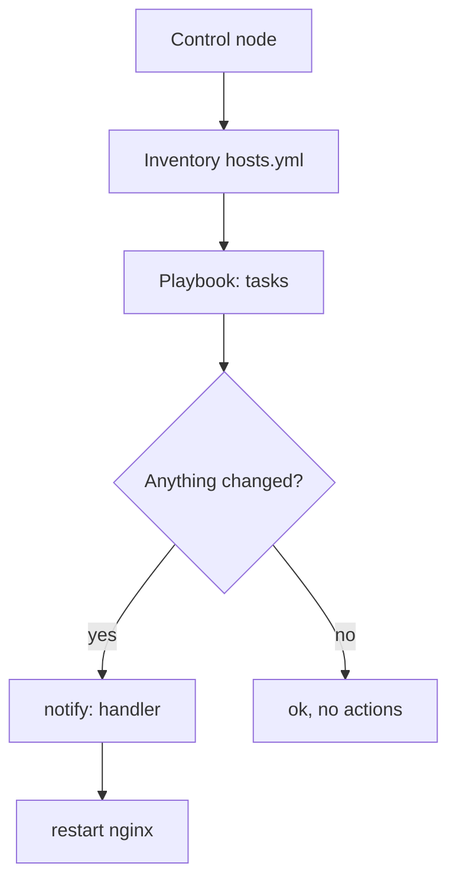

When you have one or two servers, you can still configure them by hand: log in over SSH, run commands, save a note. But once there are ten, a hundred, or a thousand, manual management breaks down: somewhere you forgot to update a package, somewhere a config differs by a couple of lines, and the servers "drift" — diverging from one another. The way out is **infrastructure as code (IaC)**: configuration is stored in files like ordinary code, versioned in Git, and applied automatically.

## What is Ansible

**Ansible** is one of the most popular configuration management tools. Its key features:

- **Agentless:** no agents need to be installed on the managed servers. Ansible connects to them over SSH and executes commands.
- **Push model:** the control node itself "pushes" configuration to hosts, unlike the pull approach of Chef/Puppet.
- **Declarative playbooks:** you describe the *desired state*, not a sequence of commands.
- **Everything in YAML:** playbooks are plain YAML files — easy to read and review.

## Inventory

An **inventory** is the list of hosts and groups managed by Ansible. It can be written in INI or YAML format. Example YAML inventory `hosts.yml`:

```yaml
all:
  children:
    web:
      hosts:
        web-01:
          ansible_host: 10.0.1.10
        web-02:
          ansible_host: 10.0.1.11
    db:
      hosts:
        db-01:
          ansible_host: 10.0.2.10
```

Groups can be nested inside one another, and variables can be declared at any level.

## Modules and ad-hoc commands

A **module** is a ready-made unit of functionality: `ping` (connection check), `apt` (packages on Debian/Ubuntu), `yum`/`dnf` (on RHEL), `service` (managing services), `copy` (copying files), `template` (copying with templating), `command`/`shell` (arbitrary commands). An ad-hoc command runs without a playbook:

```bash
ansible -i hosts.yml all -m ping
ansible -i hosts.yml web -m apt -a "name=nginx state=present"
```

Modules are **idempotent**: applying them again does not break state — if the package is already installed, Ansible does not reinstall it. This is the main difference from simple shell scripts.

## Playbooks

A **playbook** is a scenario in YAML. A minimal playbook `install_nginx.yml`:

```yaml
---
- name: Install and start Nginx
  hosts: web
  become: true
  tasks:
    - name: Install nginx
      apt:
        name: nginx
        state: present

    - name: Start and enable nginx
      service:
        name: nginx
        state: started
        enabled: true
```

Key top-level fields: `name` (playbook name), `hosts` (which group it targets), `become` (whether to run as root via sudo), `tasks` (list of tasks), `vars` (variables), `handlers` (handlers — tasks triggered by an event). A task usually contains a `name` and a call to a single module.

Running and checks:

```bash
ansible-playbook -i hosts.yml install_nginx.yml --syntax-check
ansible-playbook -i hosts.yml install_nginx.yml --check
ansible-playbook -i hosts.yml install_nginx.yml
```

`--syntax-check` verifies the YAML syntax and the playbook structure, while `--check` is a "dry run": Ansible shows what it would do without changing anything.

## Variables and Jinja2 templates

Variables are declared in `vars`, in the inventory, or in separate files. Inside templates and tasks you access them via double curly braces:

```yaml
---
- name: Configure nginx config
  hosts: web
  become: true
  vars:
    server_name: example.com
    nginx_port: 8080
  tasks:
    - name: Copy config from template
      template:
        src: nginx.conf.j2
        dest: /etc/nginx/sites-available/default
      notify: restart_nginx

  handlers:
    - name: restart_nginx
      service:
        name: nginx
        state: restarted
```

The file `nginx.conf.j2` is a Jinja2 template in which variables are substituted at runtime:

```jinja
server {
    listen {{ nginx_port }};
    server_name {{ server_name }};
    root /var/www/html;
}
```

Notice `notify: restart_nginx`: the task does not restart the service immediately, it "notifies" a handler instead. The handler runs at the end of the playbook, and only if the task actually changed something. This saves restarts and keeps the playbook idempotent.

Here is what the path of a single task looks like from the control node to the change on the server:



The diagram emphasizes the main point: the playbook does not "execute commands", it brings hosts to a state and reports exactly what changed. The `ok` branch is not an error but a sign of idempotency.

## Summary

We covered the Ansible basics: inventories, modules, playbooks, variables, templates, and handlers. Ansible is a way to turn "I fixed the server manually" into "here is a file that reproduces the server's state." Next, we'll reinforce it all with practice.

<!--TASK-->
### Task 1
Create an inventory file `hosts.yml` describing a group `web` of two hosts (`web-01` and `web-02`) with IP addresses `10.0.1.10` and `10.0.1.11`, and a group `db` with one host `db-01` at address `10.0.2.10`. For each host, set a variable `ansible_user: ubuntu`. Then write an ad-hoc command (in a comment in the file) that checks the availability of all hosts from the inventory. Expected result: you can explain why the `web` group does not contain nested groups and which YAML keys are mandatory for a host.

### Task 2
Write a playbook `install_nginx.yml` that applies to the group `web`, runs with `become: true`, and contains two tasks: installing the `nginx` package in state `present` (module `apt`) and starting the `nginx` service with `state: started` and `enabled: true` (module `service`). Add clear `name`s to both tasks. Expected result: the file must pass `ansible-playbook --syntax-check` without errors, and when inspected it is clear that every task has a name and a module.

### Task 3
Write a pytest test `test_playbook.py` that reads the playbook `install_nginx.yml` from task 2, parses it with `yaml.safe_load`, and checks: the file is a list of exactly one "play", the play has a key `hosts` with value `web`, a key `tasks` with a non-empty list, and each task contains a key `name` and at least one of the modules `apt`, `service`, `copy`, `template`, `command`, `shell`, `pip`. The test must finish without errors. Run it with `pytest test_playbook.py -v`.

### Task 4
Create a template `nginx.conf.j2` for an Nginx virtual host with variables `server_name` and `nginx_port`, plus a pytest test `test_template.py` that renders this template with Jinja2 using data `{"server_name": "example.com", "nginx_port": 8080}` and checks that the result contains the strings `server_name example.com;` and `listen 8080;`. Expected result: `pytest test_template.py -v` is green, and the test proves the template actually uses the variables.

### Task 5
Extend the playbook from task 2: add a task that copies the template `nginx.conf.j2` to `/etc/nginx/sites-available/default` (module `template`, key `notify: restart_nginx`), and a `handlers` block with a handler `restart_nginx` that restarts the `nginx` service. Then extend the test `test_playbook.py`: add a check that every task with a key `notify` refers to a handler that exists in `handlers` (by key `name`). Expected result: all tests pass, and you can explain why the handler is only invoked when the file changes.
### Task 6
Move the `web` group's variables to a separate file `group_vars/web.yml`: `ansible_user: ubuntu`, `nginx_port: 8080`, `server_name: example.com`. In `hosts.yml` leave only `ansible_host` for the hosts, and remove `nginx_port` and `server_name` from the playbook's `vars` block. Add a third task to the playbook with the module `debug` that prints the address `http://{{ server_name }}:{{ nginx_port }}`, and give it a condition `when: nginx_port != 80`. Write a test `test_vars.py`: it checks that `group_vars/web.yml` contains all three variables, that hosts in the inventory have no `ansible_user`, and that the playbook has a task with a `when` key using `nginx_port`. Expected result: `pytest test_vars.py -v` — 3 passed, and `ansible-playbook -i hosts.yml install_nginx.yml --check` does not complain about undefined variables.

### Task 7
Create a file `state.json` with the actual state: `{"web-01": 8080, "web-02": 8081, "db-01": 8080}` — these are the ports where nginx is actually listening. Write a script `drift_report.py` that reads `hosts.yml`, the desired port from `group_vars/web.yml`, and `state.json`, then prints a report, one line per host: `web-01: ok`, `web-02: drift 8080 -> 8081`, `db-01: outside web group`. The script returns exit code `1` if drift is found and `0` if everything matches. Write a test `test_drift_report.py` that runs the script via `subprocess.run` and checks the return code and all three output lines. Expected output: `web-01: ok`, `web-02: drift 8080 -> 8081`, `db-01: outside web group`, return code `1`.

<!--/TASK-->

<!--HINT-->
### Hint 1
YAML inventory format: root key `all`, inside it `children`, inside a group — `hosts` with a list of names. Host variables are ordinary keys inside it. Connection check: `ansible -i hosts.yml all -m ping` — the `ping` module does not do an ICMP ping but checks the SSH connection and the presence of Python on the host.

### Hint 2
Playbook structure: at the start `---`, then `- name: ...`, `hosts: web`, `become: true`, and a `tasks:` key with a list of tasks. Each task: `- name: ...`, then on the next line the module name (`apt:` or `service:`) with nested parameters. Don't forget indentation: exactly two spaces per nesting level.

### Hint 3
In the test use `import yaml` and `yaml.safe_load(open("install_nginx.yml", encoding="utf-8"))`. Checks via `assert`. Store the list of allowed modules in a `set`. If `yaml` is not installed, run `pip install pyyaml pytest`.

### Hint 4
Jinja2: `from jinja2 import Template`; create an object `Template(open("nginx.conf.j2", encoding="utf-8").read())` and call `.render(server_name="example.com", nginx_port=8080)`. In the template, variables are written as `{{ server_name }}` and `{{ nginx_port }}`. Check the resulting strings with `assert "..." in rendered`.

### Hint 5
The playbook gets a `handlers` key at the same level as `tasks`, containing a list of tasks with `name`. In the test, collect handler names into a set (`{h["name"] for h in handlers}`) and compare with each `notify` value from the tasks. Remember that `notify` can be a string or a list.
### Hint 6
Ansible automatically picks up `group_vars/<group_name>.yml` next to the inventory: the file structure is a flat dictionary without wrappers. In the test, read both files via `yaml.safe_load`, and find the conditional task like this: `[t for t in play["tasks"] if "when" in t]`.

### Hint 7
Collect the group's host set from the inventory and compare it with the keys of `state.json` — the difference is the "hosts outside the group". To run the script from the test use `subprocess.run(["python", "drift_report.py"], capture_output=True, text=True)` and look at `returncode` and `stdout`.

<!--/HINT-->

<!--SOLUTION-->
### Solution 1
Solution:

```yaml
all:
  children:
    web:
      hosts:
        web-01:
          ansible_host: 10.0.1.10
          ansible_user: ubuntu
        web-02:
          ansible_host: 10.0.1.11
          ansible_user: ubuntu
    db:
      hosts:
        db-01:
          ansible_host: 10.0.2.10
          ansible_user: ubuntu
# Check availability of all hosts:
# ansible -i hosts.yml all -m ping
```

What is going on here? The root key `all` unites all hosts. `children` lists the groups: `web` and `db`. Inside each group is `hosts` with a list of actual host names, and each host declares a variable `ansible_user`. The keys `ansible_host` and `ansible_user` are standard connection variables. The command `ansible -i hosts.yml all -m ping` uses the inventory (`-i hosts.yml`), the target `all` (all hosts), and the module `ping`. This module checks the SSH connection and the presence of Python, not an ICMP ping. Ad-hoc commands are convenient for quick actions, but reproducible setups use playbooks.

### Solution 2
Solution:

```yaml
---
- name: Install and start Nginx
  hosts: web
  become: true
  tasks:
    - name: Install nginx
      apt:
        name: nginx
        state: present

    - name: Start and enable nginx
      service:
        name: nginx
        state: started
        enabled: true
```

What is going on here? A playbook is a list containing one "play" — a block with `hosts` and `tasks`. The key `become: true` tells Ansible to run tasks as root via sudo. The first task uses the `apt` module and ensures the `nginx` package is installed (`state: present`). The second — the `service` module — starts the service and adds it to startup. `ansible-playbook -i hosts.yml install_nginx.yml --syntax-check` will confirm the YAML and structure are correct. Importantly, every task has a `name` — Ansible uses it to show progress and to let other tasks reference it from `notify`.

### Solution 3
Solution:

```python
import yaml


def load_playbook(path="install_nginx.yml"):
    with open(path, encoding="utf-8") as f:
        return yaml.safe_load(f)


MODULES = {"apt", "service", "copy", "template", "command", "shell", "pip"}


def test_playbook_is_single_play():
    pb = load_playbook()
    assert isinstance(pb, list)
    assert len(pb) == 1


def test_play_has_hosts_and_tasks():
    play = load_playbook()[0]
    assert play.get("hosts") == "web"
    assert "tasks" in play
    assert isinstance(play["tasks"], list)
    assert len(play["tasks"]) >= 2


def test_every_task_has_name_and_known_module():
    for task in load_playbook()[0]["tasks"]:
        assert "name" in task, "task has no name"
        assert any(mod in task for mod in MODULES), \
            f"task {task.get('name')} does not use a known module"
```

What is going on here? The first test checks that `yaml.safe_load` returned a list of exactly one element — our play. The second — that the play has `hosts` with value `web` and a non-empty `tasks` list. The third — iterates over each task and checks for `name` and at least one known module (intersection of the task's keys with the `MODULES` set). Such a test is a lightweight "linter" for the playbook: it catches typos in structure before the playbook goes to real servers. Run: `pytest test_playbook.py -v`.

### Solution 4
Solution. Template `nginx.conf.j2`:

```jinja
server {
    listen {{ nginx_port }};
    server_name {{ server_name }};
    root /var/www/html;
}
```

Test `test_template.py`:

```python
from jinja2 import Template


def render_template(path, **data):
    with open(path, encoding="utf-8") as f:
        return Template(f.read()).render(**data)


def test_nginx_template_renders_variables():
    out = render_template("nginx.conf.j2", server_name="example.com", nginx_port=8080)
    assert "server_name example.com;" in out
    assert "listen 8080;" in out
```

What is going on here? The function `render_template` reads the template file and renders it with Jinja2, substituting the data. The template uses `{{ variable }}` syntax, and after rendering the substituted values must appear in the result. The test checks this with two `assert`s. If the template had a typo (for example, `{{ nginx_por }}`), the variable would not be substituted and the test would fail — this is exactly how automation catches configuration drift before deployment.

### Solution 5
Solution. Playbook with a handler:

```yaml
---
- name: Install and start Nginx
  hosts: web
  become: true
  vars:
    server_name: example.com
    nginx_port: 8080
  tasks:
    - name: Install nginx
      apt:
        name: nginx
        state: present

    - name: Copy config from template
      template:
        src: nginx.conf.j2
        dest: /etc/nginx/sites-available/default
      notify: restart_nginx

  handlers:
    - name: restart_nginx
      service:
        name: nginx
        state: restarted
```

Extended test:

```python
def test_notify_refers_to_handler():
    play = load_playbook()[0]
    handler_names = {h.get("name") for h in play.get("handlers", [])}
    for task in play["tasks"]:
        notify = task.get("notify")
        if notify is None:
            continue
        for target in (notify if isinstance(notify, list) else [notify]):
            assert target in handler_names, f"handler {target} is not declared"
```

What is going on here? The `notify` key links a task to a handler: if the task actually changed state (the file was copied anew), Ansible will run `restart_nginx` at the end of the playbook. If nothing changed — the handler won't fire, and the service won't be restarted needlessly. The test collects handler names into a set and checks that every name from `notify` (string or list) is present. This guards against the classic "handler not found" error on a real run.
### Solution 6
Solution. `group_vars/web.yml`:

```yaml
ansible_user: ubuntu
nginx_port: 8080
server_name: example.com
```

`hosts.yml` — without host variables:

```yaml
all:
  children:
    web:
      hosts:
        web-01:
          ansible_host: 10.0.1.10
        web-02:
          ansible_host: 10.0.1.11
```

Playbook fragment:

```yaml
    - name: Show service address
      debug:
        msg: "http://{{ server_name }}:{{ nginx_port }}"
      when: nginx_port != 80
```

Test `test_vars.py`:

```python
import yaml


def load(path):
    with open(path, encoding="utf-8") as f:
        return yaml.safe_load(f)


def test_group_vars_web():
    data = load("group_vars/web.yml")
    assert data["ansible_user"] == "ubuntu"
    assert data["nginx_port"] == 8080
    assert data["server_name"] == "example.com"


def test_inventory_has_no_duplicated_vars():
    inv = load("hosts.yml")
    for host in inv["all"]["children"]["web"]["hosts"].values():
        assert "ansible_user" not in host


def test_playbook_uses_group_vars():
    play = load("install_nginx.yml")[0]
    conditional = [t for t in play["tasks"] if "when" in t]
    assert conditional, "no task with when"
    assert any("nginx_port" in str(t) for t in conditional)
    assert "nginx_port" not in play.get("vars", {})
```

What is going on here? `group_vars/web.yml` is the standard place for group variables: Ansible reads it automatically, without `vars_files`. The variables apply to all hosts of the `web` group, so duplicating `ansible_user` in the inventory is no longer needed — and the test enforces it. The task with `debug` changes nothing on the server, and `when` demonstrates conditional execution: on an environment with port `80`, the extra line is not printed. The third test also forbids moving variables back into the playbook: one variable must live in one place, otherwise environments will start drifting again.

### Solution 7
Solution. `drift_report.py`:

```python
import json
import sys

import yaml


DESIRED_FILE = "group_vars/web.yml"
INVENTORY = "hosts.yml"
STATE = "state.json"


def main():
    with open(INVENTORY, encoding="utf-8") as f:
        inv = yaml.safe_load(f)
    with open(DESIRED_FILE, encoding="utf-8") as f:
        desired = yaml.safe_load(f)["nginx_port"]
    with open(STATE, encoding="utf-8") as f:
        actual = json.load(f)

    web_hosts = sorted(inv["all"]["children"]["web"]["hosts"])
    drift = False

    for host in web_hosts:
        port = actual.get(host)
        if port is None:
            print(f"{host}: no data")
            drift = True
        elif port != desired:
            print(f"{host}: drift {desired} -> {port}")
            drift = True
        else:
            print(f"{host}: ok")

    for host in sorted(set(actual) - set(web_hosts)):
        print(f"{host}: outside web group")

    return 1 if drift else 0


if __name__ == "__main__":
    sys.exit(main())
```

Test `test_drift_report.py`:

```python
import subprocess


def run():
    return subprocess.run(
        ["python", "drift_report.py"],
        capture_output=True,
        text=True,
        check=False,
    )


def test_drift_exit_code():
    assert run().returncode == 1


def test_drift_output_lines():
    out = run().stdout
    assert "web-01: ok" in out
    assert "web-02: drift 8080 -> 8081" in out
    assert "db-01: outside web group" in out
```

What is going on here? The script is a small model of what Ansible does in `--check` mode: it takes the desired state (`group_vars`), the actual state (`state.json`), and prints the discrepancies. The host order comes from the inventory and is sorted, so the output is stable and can be tested. Hosts from `state.json` that are not in the group get their own line — that is also drift, just an "extra" host. The return code makes the script CI-ready: a non-zero code stops the pipeline. The test runs an actual process rather than a function, so argument parsing and the full output format are verified.

<!--/SOLUTION-->

<!--QUIZ-->
What is Ansible?
- Agentless configuration management tool
- Python compiler
- Database
* Correct answer: Agentless configuration management tool
Ansible connects to hosts via SSH and requires no agent installation.

Which protocol does Ansible use to connect to managed hosts?
- SSH
- FTP
- SMTP
* Correct answer: SSH
Ansible is an agentless tool that works over SSH.

What does an inventory describe?
- A list of hosts and groups
- A list of tasks
- Python versions
* Correct answer: A list of hosts and groups
An inventory lists hosts, groups, and their variables.

Which playbook key allows running tasks as root?
- sudo
- become
- root
* Correct answer: become
become: true enables privilege elevation via sudo.

What is the check of a playbook without real changes called?
- --check
- --dry-run-2
- --preview
* Correct answer: --check
--check performs a dry run: it shows what would change without changing anything.

Which module copies a file with variable substitution?
- copy
- template
- shell
* Correct answer: template
The template module uses Jinja2 and substitutes variables into the template.

What are handlers for?
- They run at the end of the playbook only when state changes
- They always run at the beginning
- They replace modules
* Correct answer: They run at the end of the playbook only when state changes
A handler fires on notify and only if a task changed something.

What does module idempotency mean?
- Applying again does not change already-correct state
- The module can be run only once
- The module deletes all files
* Correct answer: Applying again does not change already-correct state
Idempotency — a second run does not break the system state.

In what format are playbooks written?
- YAML
- JSON
- XML
* Correct answer: YAML
Ansible playbooks are plain YAML files.

Which module installs packages on Debian/Ubuntu?
- apt
- yum
- pip
* Correct answer: apt
The apt module manages packages on apt-based systems (Debian, Ubuntu).
What does the flag --limit web do?
- Limits execution to hosts of the web group
- Speeds up the playbook twice
- Removes the web group from the inventory
* Correct answer: Limits execution to hosts of the web group
--limit narrows the set of targets without changing the playbook itself.

Where does Ansible look for variables of the web group?
- In the group_vars/web.yml file next to the inventory
- In the vars/web.ini file inside the playbook
- Only on the command line
* Correct answer: In the group_vars/web.yml file next to the inventory
group_vars is picked up automatically, without vars_files.

What does the changed status of a task mean?
- The task changed the host's state
- The task failed with an error
- The task was skipped
* Correct answer: The task changed the host's state
changed shows real changes; ok means the state already matched.

What does serial: 1 do in a playbook?
- Runs the play on hosts one at a time
- Runs the play exactly once
- Limits the play to one task
* Correct answer: Runs the play on hosts one at a time
serial sets the "wave" size and is used for rolling updates.

<!--/QUIZ-->
